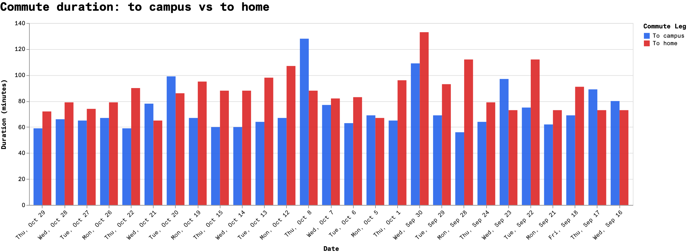
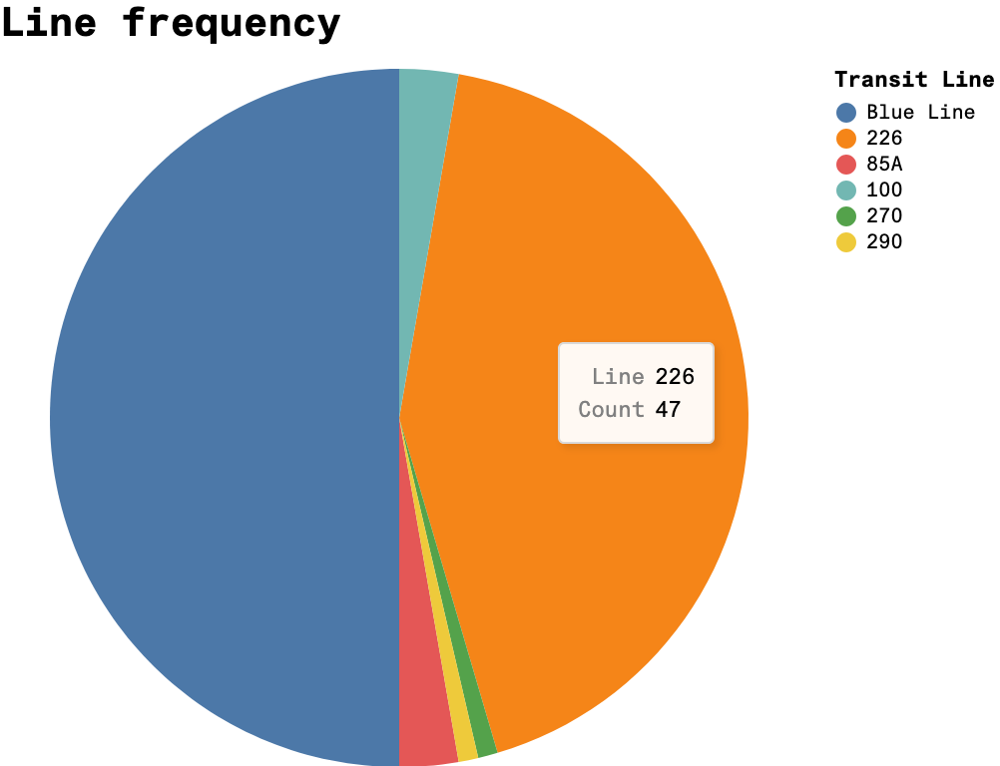
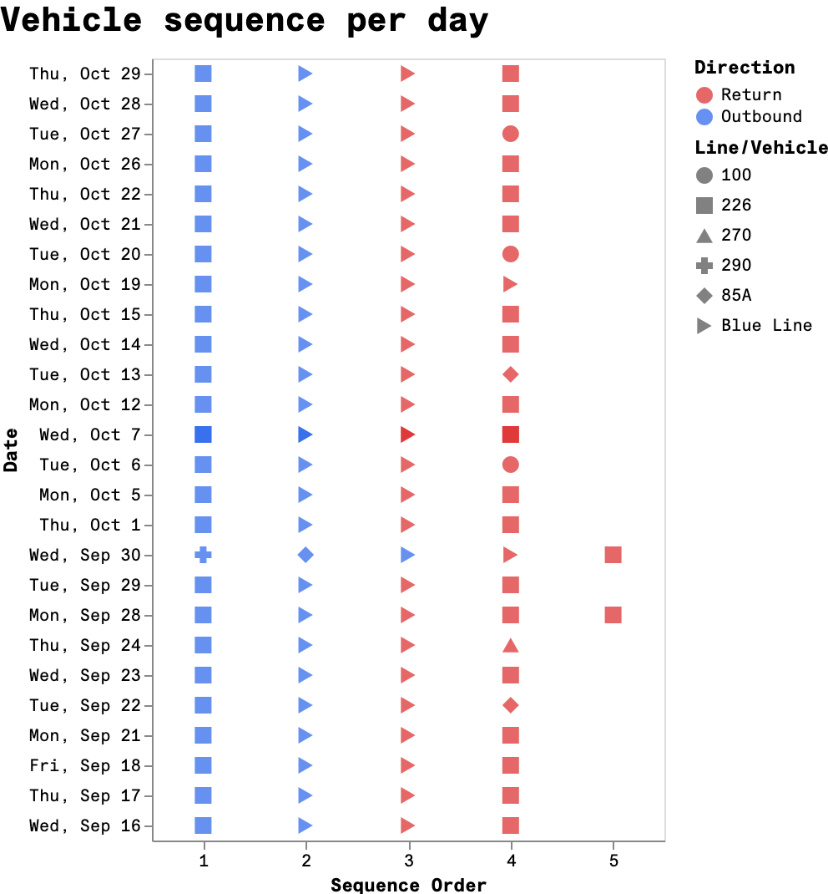

	# process and documentation

## T1: Guiding questions

All the data I've collected so far has been very concrete, most
of it being temporal, with the rest being categorical and
quantitative. The current state of the data has some holes in it:
some null values, which represent items I had forgotten to
collect during my commute, or that which I could not remember
exactly what the data value was.

For now, I'll focus on the four domain questions I generated
previous, those being:

- Q1: How long am I away from home on days I commute to campus?
- Q2: Which routes end up taking the longest?
- Q3: Are certain days more prone to variation in my commute?
- Q4: How much downtime do I usually have before my first class
  of the day?

The relevant attributes that seem necessary to analyze in order
to answer the above questions are listed below:

From commute timestamps table:
- day
- leave\_home
- arrive\_school
- leave\_school
- arrive\_home

From vehicle trip observations table:
- day
- order
- name
- returning

Of course, Q4 requires analysis of my class schedule, more
specifically, the starting times of my classes.

## T2: Data transformation

### Planned transformations by table

**Timestamps**
- turn timestamps into datetimes by appending corresponding day
  information
- calculate commute durations for each leg of the commute (home
  to campus, campus to home)

**Vehicle trips**
- map vehicle trips to routes (geographic path)

## T3: Exploratory visualizations

I thought the commute durations visualization was the most
usefule of the three, as it could give way to seeing trends I
hadn't considered before. One transformation I could see being
useful is grouping the bars by day of the week, as comparison
between the same course schedule on different days could be
useful in seeing how my commute varies.

The pie chart mostly told me what I already knew, that my commute
is dominated by the bus that goes straight to/from my home and
the blue line train. However, it could be useful for a user
unaquainted with my commute habits.

The vehicle order sequence visualization seemed like it could be
interesting, but I don't find it as useful with the way it's
currently visualized. I don't think the marks distinguished by
shapes are distinct enough to be useful, and the visualization
could probably benefit from adjusting the spacing between marks.
